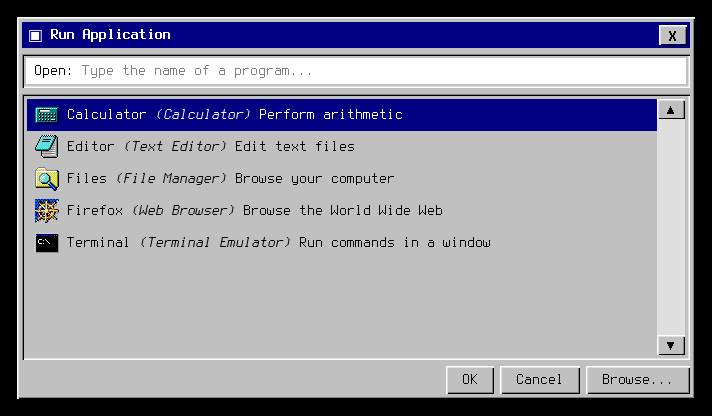
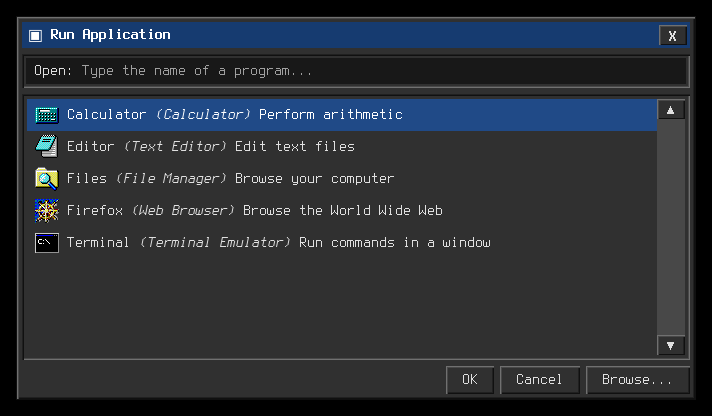

# rofi-win98

A Windows 98–style theme for [rofi](https://github.com/davatorium/rofi), the dmenu
replacement. Pure theme configuration — no forked binary, no patch, no build step.



## Features

- Grey dialog chrome with 4-tone raised and sunken bevels
- Dark mode variant with charcoal chrome, light text, and blue accents
- Title bar with title and working close control
- Sunken white input field with an Open affordance
- Dense result rows: name, generic name, and comment
- Working OK / Cancel controls and a visual-only Browse control
- Scrollbar arrows capping a narrow trough column (visual-only)
- Pixel-level visual regression tests on X11 and native Wayland

## Requirements

| Dependency | Purpose | Install |
| --- | --- | --- |
| `rofi` >= 2.0 | the launcher | distro package, or [releases](https://github.com/davatorium/rofi/releases/latest) |
| `Chicago95` | icon theme (`icon-theme: "Chicago95"`) | distro package, or [grassmunk/Chicago95](https://github.com/grassmunk/Chicago95) |
| Terminus fonts | UI font (`Terminus 12`) | distro package, e.g. `terminus-font` |

The theme falls back gracefully: without Chicago95 icons render as generic
placeholders, and without Terminus text renders in the system default.

## Installation

Copy the theme into your XDG config directory:

```bash
mkdir -p ~/.config/rofi
cp win98.rasi win98-dark.rasi ~/.config/rofi/
```

Then point rofi at it. Either add an `@theme` directive to your `config.rasi`:

```
@theme "~/.config/rofi/win98.rasi"
```

or pass it per-invocation:

```bash
rofi -show drun -theme ~/.config/rofi/win98.rasi
```

For dark mode, use `win98-dark.rasi` instead:

```bash
rofi -show drun -theme ~/.config/rofi/win98-dark.rasi
```

Or set `@theme "~/.config/rofi/win98-dark.rasi"` in `config.rasi`.
Keep both theme files in the same directory: the dark variant imports the shared
layout and controls from `win98.rasi` and overrides only the palette.

## Screenshots



| Case | Light | Dark |
| --- | --- | --- |
| Run dialog, default selection | [`drun.png`](tests/reference/drun.png) | [`drun.png`](tests/reference/dark/drun.png) |
| Run dialog, moved selection | [`drun-selected.png`](tests/reference/drun-selected.png) | [`drun-selected.png`](tests/reference/dark/drun-selected.png) |
| Line input, default selection | [`dmenu.png`](tests/reference/dmenu.png) | [`dmenu.png`](tests/reference/dark/dmenu.png) |
| Line input, moved selection | [`dmenu-selected.png`](tests/reference/dmenu-selected.png) | [`dmenu-selected.png`](tests/reference/dark/dmenu-selected.png) |

These images are the blessed references for the visual test suite, so
what you see above is exactly what the tests pin. A compact virtual desktop
leaves a small border around the dialog without cropping or scaling the images.

## Development

The test suite renders four cases per theme on isolated X11 and Wayland displays
and diffs the results against the same blessed references with normalized RMSE
(threshold 0.01). Both backends use a 712×416 output at scale 1, leaving a
16-pixel desktop border around the 680×384 Run dialog (the shorter line-input
dialog has more vertical space).
Development dependencies are provided by `shell.nix`:

X11 (Xvfb and Openbox):

```bash
nix-shell --run "tests/render.sh && tests/compare.py"
```

Native Wayland (headless Sway, software rendering, Xwayland disabled):

```bash
nix-shell --run "tests/render.sh --backend wayland && tests/compare.py --current out/wayland"
```

Dark mode (X11 and Wayland):

```bash
nix-shell --run "tests/render.sh --theme ./win98-dark.rasi --out out/dark && tests/compare.py --reference tests/reference/dark --current out/dark"
nix-shell --run "tests/render.sh --backend wayland --theme ./win98-dark.rasi --out out/dark/wayland && tests/compare.py --reference tests/reference/dark --current out/dark/wayland"
```

The render commands create their own display and clean up only their own processes,
so they can run from an existing desktop session. Sway and Grim are included in
`shell.nix` for Wayland testing.

The drun renders use a fresh `XDG_DATA_HOME` to exclude user-installed
applications and icon overrides. Font-only directories in `XDG_DATA_DIRS` are
preserved so Terminus supplied by `shell.nix` remains available.

To verify isolation on both backends with an extra user-installed application:

```bash
nix-shell --run "tests/test-isolation.sh"
```

To run the comparator's unit tests:

```bash
nix-shell --run "python3 -B -m unittest discover -s tests"
```

`tests/render.sh` writes X11 screenshots to `out/` and Wayland screenshots to
`out/wayland/`. Use `--out DIR` to choose another output directory and
`--theme FILE` to select a theme.
`tests/compare.py` compares screenshots to `tests/reference/` and writes a
red-amplified diff on failure.

To re-bless references after an intentional visual change, run
`tests/render.sh` and copy the new PNGs over `tests/reference/`, then check both
backends against the updated references. For dark mode, render with
`--theme ./win98-dark.rasi --out out/dark` and copy its PNGs to
`tests/reference/dark/`.

## Known limitations

- Scrollbar arrows are **visual-only**: the wheel and arrow keys scroll the list,
  but clicking the arrows or dragging the trough does nothing.
- Browse is **visual-only** and does not open a file picker. OK accepts the
  selection; Cancel and the title-bar close control dismiss the launcher.
- The title-bar background and bevels are non-interactive decoration.

## License

GPL-2.0-only. See [LICENSE](LICENSE).

Parts of the Windows 98 visual design are Microsoft's; this project is an
independent reimplementation from scratch and ships no Microsoft code, assets,
or fonts.
